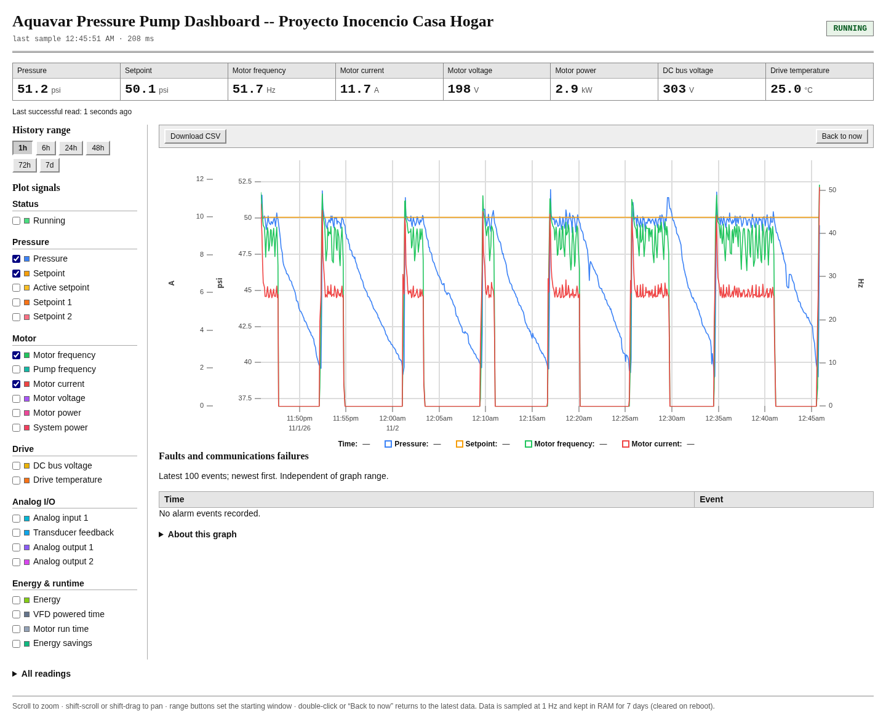

# Aquavar CPC dashboard

One Python process that samples the VFD of the pressure pump at Proyecto Inocencio Casa Hogar at 1 Hz and serves a zoomable uPlot
dashboard.  History is stored in SQLite on tmpfs (`/dev/shm/pump.db`), so the
Pi's SD card is never written to.  History is therefore volatile across reboots.

## Live dashboard

Open the pump dashboard at https://vfdmonitor.tail0fe945.ts.net.

Running on a Raspberry Pi 3B+ and exposed over HTTPS using Tailscale Funnel.



## How it fits together

```
pump_dashboard.py
├─ sampler thread  → read_pump() @ 1 Hz → INSERT into /dev/shm/pump.db
└─ main thread     → ThreadingHTTPServer on 0.0.0.0:8080
                     ├─ /                 static/index.html
                     ├─ /static/uplot.*   vendored uPlot 1.6.31
                     ├─ /api/meta         field list + units + defaults
                     ├─ /api/latest       newest sample, recent read errors
                     ├─ /api/series       server-side bucketed history
                     └─ /api/errors       read failures
```

- Measurements are stored **decoded** (named REAL columns).  Status/fault raw
  words are kept alongside them, plus decoded active fault/alarm names.
- Retention is **7 days** (about 100 MB / 605k rows), trimmed once a minute.
- Failed reads are written to `read_errors` and skipped; the 1 Hz grid continues.
- The sampler uses `timeout=0.25, retries=0`, so even a failed read fits inside
  its one-second slot.

## Requirements

- Python 3.9+ (standard library only, apart from `pyserial`)
- `pyserial` for the USB serial link to the VFD

On Debian/Raspberry Pi OS the packaged version is enough:

```sh
sudo apt install python3-serial
```

Or, in a virtualenv:

```sh
python3 -m venv .venv
.venv/bin/pip install -r requirements.txt
```

The user that runs the service must be able to open the serial device
(`/dev/ttyUSB0`), which normally means membership in the `dialout` group:

```sh
sudo usermod -aG dialout "$USER"   # log out/in afterwards
```

## Run manually

```sh
python3 -B pump_dashboard.py
# then open http://<host>:8080/
```

Environment overrides: `PUMP_DB`, `PUMP_HOST`, `PUMP_PORT`,
`PUMP_RETENTION_DAYS`, `PUMP_TIMEOUT`, `PUMP_RETRIES`.

## Install as a service

```sh
sudo ./install.sh
```

The script creates a dedicated system account (default `pumpdash`), fills in
`User=`, `Group=`, `WorkingDirectory=` and `ExecStart=` from the machine it
runs on, installs the unit, enables it, and (re)starts the service.  Re-running
it is safe.

- The service runs as a system account that never logs in.  logind's
  `RemoveIPC` cleanup unlinks `/dev/shm` objects owned by a user when that
  user's last session ends; keeping the database owned by a system UID leaves
  `RemoveIPC` at its default (`yes`) and the database untouched.  Override the
  name with `--system-user NAME`, or run as an existing account with
  `--user NAME` (not recommended: logging that account out can delete the
  database).
- `Group` defaults to `dialout`, which is what grants access to
  `/dev/ttyUSB0`.  Override with `--group`.
- `WorkingDirectory` is the directory containing the script.  If that path is
  not traversable by the system account (for example a `0700` home directory),
  the script adds execute-only permission on the blocking directories.
- `ExecStart` uses the `python3` found on the invoking user's `PATH`.  For a
  virtualenv, pass `--python /path/to/.venv/bin/python3`.

The script also adds the account to `dialout` if needed (for running the
sampler by hand; the unit's `Group=` is sufficient for the service).

The unit sets `PYTHONDONTWRITEBYTECODE=1`, disables core dumps, gives the
service a private `/tmp`, and writes logs to `/dev/shm/pump-dashboard.log`
(RAM) rather than the SD card.

Serving on `0.0.0.0:8080` is the whole deployment.  Reaching it from outside
the LAN (VPN, Tailscale Funnel, reverse proxy, etc.) is optional and is not
part of this repository.

### Manual install

If you would rather not use the script, create the system account first, edit
the four machine-specific lines in `pump-dashboard.service`, then:

```sh
sudo useradd --system --no-create-home --home-dir /nonexistent \
    --shell /usr/sbin/nologin --groups dialout pumpdash
sudo cp pump-dashboard.service /etc/systemd/system/
sudo systemctl daemon-reload
sudo systemctl enable --now pump-dashboard
systemctl status pump-dashboard
```

Without the dedicated system account, the database belongs to a login user and
logind may delete it from `/dev/shm` when that user's last session ends.

## Web UI

- Range buttons: 1h / 6h / 24h / 48h / 72h / 7d.  They set the starting window.
- Scroll (or pinch on a trackpad) to zoom continuously around the cursor; drag
  to zoom into a selection.  The visible window is re-fetched after a short
  debounce with a bucket size matched to the zoom
  (`max(1 s, window / 1500)`, rounded up to a readable interval).
- Shift-scroll (or a horizontal trackpad swipe) and shift-drag pan left and
  right through history.  Panning stops the 10 s live refresh, so the window
  stays where you put it instead of snapping back to the newest data.
- Double-click or **Back to now** returns to the selected range button and
  resumes live updates.
- Check any combination of measurements; each unit gets its own y-axis.
- **Running** is stored per sample (0 or 100) from the decoded status summary;
  at 1 s buckets it is 0/100, and when zoomed out it is the percentage of each
  bucket the pump was running.
- Tiles and the status/fault banner poll `/api/latest` every 2 s.

## Storage notes

```sql
PRAGMA journal_mode=WAL;      -- readers never block the writer
PRAGMA synchronous=OFF;       -- RAM only, durability is irrelevant
PRAGMA temp_store=MEMORY;     -- never spill to /tmp
```

The writer checkpoints the WAL every minute.  Because everything lives in
`/dev/shm`, the database, WAL, shared-memory file and logs are all RAM-backed.

The database files are owned by the service's system account.  logind's
`RemoveIPC` cleanup only removes `/dev/shm` objects owned by the UID that just
logged out, so normal login sessions can still clean up their own shared
memory without touching `pump.db`.
